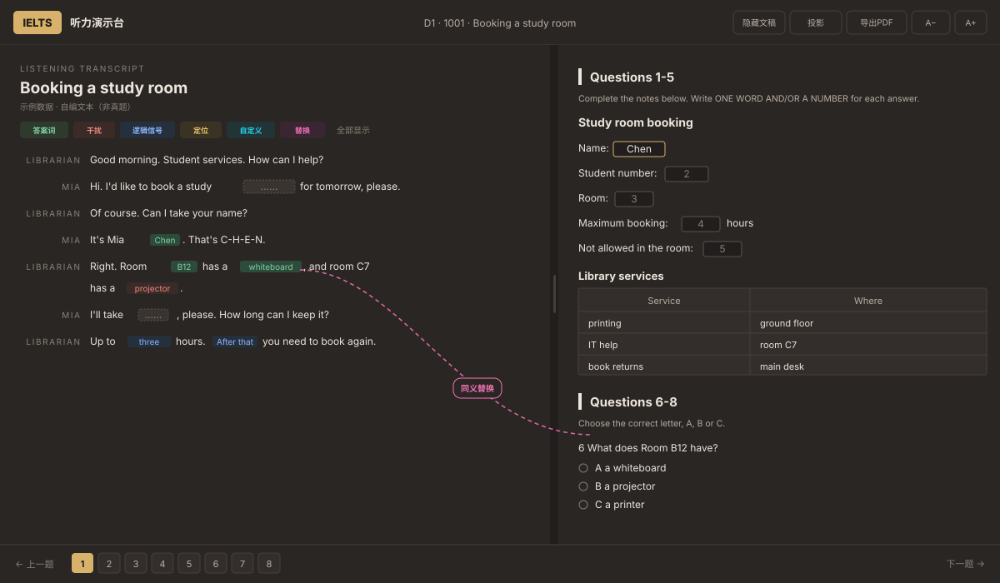

# 雅思听力演示台（IELTS Listening Stage）

一个给雅思听力老师用的**离线单文件演示台**：左边听力原文、右边题目，支持标注挖空、同义替换连线、富文本笔记、投影演讲者视图，并能导出和网页同版式的 PDF。整个应用只有一个 `.html` 文件，双击即用，不联网、不装依赖。

> A single-file, offline classroom display for IELTS Listening teachers: transcript + questions side by side, answer blanking, synonym link lines with notes, rich-text notes, presenter view, and web-like PDF export.



## 功能

**文稿与标注**

- 左右两栏 + 可拖拽分隔条，文稿可整块隐藏（快捷键 `T`）
- 五类彩色标注：答案词、干扰、逻辑信号、定位、自定义；每类可一键「显示原文 / 挖空」，彩色空格点一下可看词
- 划词工具：先点类别再划词即标；不选类别时划词加下划线
- 单击挖空处弹出菜单：显示原文 / 挖空、编辑这个标记、删除这个标记
- 撤销 / 重做只作用于当前一侧（文稿标记、题目批注、作答各自独立）

**题目**

- 四种题型：填空（笔记式 / 表格）、单选、多选、匹配（含地图题「图 + 字母表」版式）
- 只有圆点 / 方框能作答，点选项文字不会误选；选项文字本身可以划词标注
- 填空自动撑宽、按题号存答案；「答」按钮逐题揭晓参考答案
- 点填空空格或题号，左侧文稿自动跳到对应答案句并高亮
- 题目侧高亮 / Note / 同义替换连线；题目笔记面板

**同义替换连线**

- 文稿词 ↔ 题目词，粉色虚线贝塞尔曲线
- 释义直接显示为连线上的泡泡，可沿曲线拖动；点泡泡改释义或删除
- 支持反向连线（先在题目选，再去文稿选）；Esc 取消

**笔记**

- 类 Word 富文本面板（段落样式、字号、加粗 / 斜体 / 下划线 / 删除线、颜色、背景色、列表、对齐、图片粘贴）
- 每篇独立保存，停止输入 500ms 自动存本机；可全屏、可拖动、可改大小
- 投影时学生端同步看到同样的内容和滚动位置

**投影 / 演讲者视图**

- 另开窗口放到第二块屏，和主窗口同布局的实时镜像
- 文稿默认隐藏（只有老师端能看到原文），可随时给学生看
- 字号、左右分栏、滚动、标注、高亮、笔记、连线、已填答案、揭晓答案全部同步

**导出 PDF**

- **网页版**（默认）：左右两栏、还原替换连线与释义泡泡，整节排成一张超长页，最接近网页
- **A4 单栏**：自动分页、省纸，适合打印到纸
- 两种都包含：彩色标注、高亮、下划线、已填答案、富文本笔记、题目批注

**其他**

- 三套配色（浅色 / 深色 / 高对比）、字号 15–26px 连续缩放
- 配图上传 / 粘贴 / 替换 / 移除，自动压成 WebP 存本机，随导出打印
- 全部改动自动存 `localStorage`，关页有未保存提醒；可把当前状态「存为初始」
- 零外链、零网络请求，断网可用

## 快速开始

```bash
git clone https://github.com/OneCanType/ielts-listening-stage.git
cd ielts-listening-stage
open ielts-listening-stage.html      # macOS；Windows 直接双击文件
```

也可以直接拖进 Chrome / Edge。推荐 Chrome / Edge 100+（用到 `document.execCommand`、`window.open` + `document.write`、`beforeprint`）。

> 用本地服务器打开也可以（`python3 -m http.server`），但不是必需：没有任何 `fetch`。

## 目录结构

```
ielts-listening-stage/
├── ielts-listening-stage.html   # 应用本体 + 自编示例数据（1 单元 / 3 节 / 20 题）
├── index.html                 # GitHub Pages 入口，自动跳到上面的文件
├── README.md
├── LICENSE
├── NOTICE.md                  # 内容版权说明
├── .gitignore                 # 忽略 private/、_src/、导出文件
├── docs/
│   ├── 开发规范.md            # 架构、状态、渲染、交互、扩展、测试、已知坑
│   ├── 篇目数据规范.md        # JSON 结构、题型、标注坐标、新增/删除篇目步骤
│   └── screenshot.svg         # 界面示意图（矢量）
├── tools/
│   ├── check-data.py          # 题库静态校验（题号/答案/标注边界…）
│   ├── apply-data.py          # 把任意题库 JSON 注入 HTML（含 --demo）
│   ├── demo_data.py           # 示例题库源文件（文本 + 标注，坐标自动算）
│   ├── make-demo-map.py       # 生成示例地图（本地 webp，不提交）
│   └── demo-map.b64           # 地图的 base64 文本（仓库用它）
├── private/                   # 真实题库（本地目录，不在仓库里）
└── _src/                      # 本地备份（本地目录，不在仓库里）
```

## 老师怎么用

1. 顶栏选篇目 → 点「显示文稿」展开原文（默认隐藏，方便先让学生听）。
2. 图例里点「划词」的类别（答案 / 干扰 / 逻辑 / 定位 / 自定义 / 替换），再在文稿里划词。
3. 讲同义替换：点「替换」→ 划文稿词 → 去题目里划对应词 → 在泡泡里写中文释义。
4. 讲题时点题号或空格，左边自动跳到答案句；点「答」揭晓参考答案。
5. 需要学生看原文时点顶栏「投影」，把投影窗口拖到第二块屏，再在投影窗口上方点「显示文稿」。
6. 课后「导出PDF」→ 版式选「网页版」→ 打印窗口里「另存为 PDF」。

## 数据与隐私

- 所有标注、答案、笔记、配图都存在**当前浏览器**的 `localStorage`，不上传任何服务器。
- 示例版用的 key 是 `ielts-listening-sim-demo`；完整题库版用 `ielts-listening-sim-v1`（`apply-data.py --ls` 可改）。两套数据互不干扰。
- 换浏览器 / 清缓存 = 换一份数据。要带走请用「导出PDF」，或先把当前状态「存为初始」。
- `localStorage` 大约 5MB；配图会被压到 WebP（最长边 1500px，质量 0.92），但塞太多图仍可能写满，写满时会提示先导出留档。

## 公开版与完整版

这是「公开代码、剥离数据」的做法：

| 文件 | 数据 | 用途 |
| --- | --- | --- |
| `ielts-listening-stage.html`（仓库根） | **自编示例**：1 单元 / 3 节 / 20 题 | 公开仓库、GitHub Pages、给人演示 |
| `private/ielts-listening-stage.full.html` | 真实题库（30 节 / 264 题） | 自己上课用，**不进 Git** |
| `private/ielts-full-data.json` | 真实题库纯数据 | 备份 / 重新生成完整版 |

`private/` 已被 `.gitignore` 忽略。换机器时单独拷贝这个目录即可。

```bash
# 改完示例数据（tools/demo_data.py）后重新注入
python3 tools/apply-data.py --demo --ls ielts-listening-sim-demo --ver demo-2026-10-24

# 重新生成完整版（不要输出到根目录，避免误提交）
python3 tools/apply-data.py private/ielts-full-data.json \
  --out private/ielts-listening-stage.full.html \
  --ls ielts-listening-sim-v1 --ver 2026-10-24b
```

## 更新仓库

仓库已经托管在 GitHub，改完文件直接提交：

```bash
git add .
git commit -m "更新示例题库 / 文档"
git push
```

**在线演示（GitHub Pages）**：Settings → Pages → Source 选 `Deploy from a branch`，分支 `main`、目录 `/ (root)`。开启后访问 `https://onecantype.github.io/ielts-listening-stage/`，会自动跳到示例版。

## 开发与扩展

- 想改功能 / 加题型 / 加标注类别：看 [docs/开发规范.md](docs/开发规范.md)
- 想加一节听力、换题库：看 [docs/篇目数据规范.md](docs/篇目数据规范.md)，改完跑一遍：

```bash
python3 tools/check-data.py ielts-listening-stage.html
```

- 改示例题库：编辑 `tools/demo_data.py`（文本 + 标注词表），然后 `python3 tools/apply-data.py --demo`。
- 换掉示例地图：改 `tools/make-demo-map.py` 后运行 `python3 tools/make-demo-map.py`，再重新注入数据。

## 关于内容版权

仓库里**只有自编示例数据**（`<script id="data">`，3 节对话/独白与一张自绘示意图），可以随代码一起公开。示例文本、题目、地图都是为本项目编写的，不含剑桥真题。

真实题库保存在本地 `private/`，请勿提交、勿公开发布；如果误提交了，需要重写 Git 历史（`git filter-repo`）才能彻底移除。

详见 [NOTICE.md](NOTICE.md)。

## 许可证

代码与自编示例数据采用 MIT（见 [LICENSE](LICENSE)）；雅思（IELTS）是剑桥大学考试委员会等相关机构的注册商标，本项目与其无隶属关系。若你在本地另行注入真题内容，那些内容的版权归原权利人，不在本许可证范围内。
